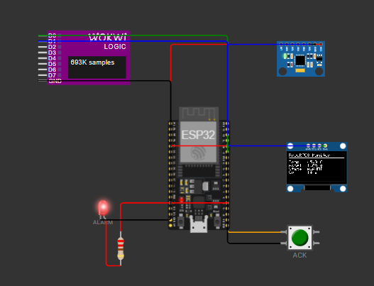
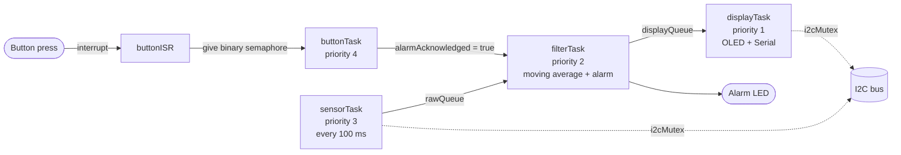
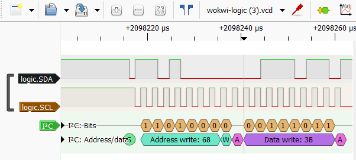
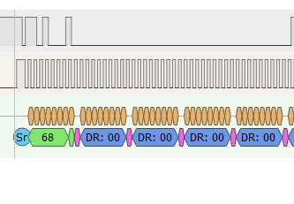
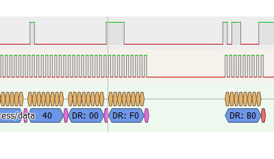

# FreeRTOS Sensor Monitoring System (ESP32)

A multi-task FreeRTOS firmware for the ESP32 that reads an MPU6050 sensor over I2C, filters the readings, shows them on an SSD1306 OLED and raises an alarm when the temperature goes above a limit. The project runs in the [Wokwi](https://wokwi.com) simulator, so no hardware is needed.

**Live simulation:** _add your Wokwi project link here_

## Features

- **4 FreeRTOS tasks** with different priorities: button handling, sensor sampling, filtering and display
- **Queues** to pass data between tasks (`rawQueue`, `displayQueue`)
- **Mutexes** to share the I2C bus (sensor + OLED) and the serial port safely between tasks
- **Interrupt service routine + binary semaphore** for the button, with the work deferred to a high-priority task
- **8-sample moving average** filter using a circular buffer with running sums
- **Temperature alarm** with an LED and an acknowledge button
- **I2C bus capture** with a logic analyzer, decoded in PulseView

## Hardware (simulated)

| Part | Connection |
|---|---|
| ESP32 DevKit-C | Main controller |
| MPU6050 (I2C, 0x68) | SDA → GPIO 21, SCL → GPIO 22 |
| SSD1306 OLED 128x64 (I2C, 0x3C) | Same I2C bus: SDA → GPIO 21, SCL → GPIO 22 |
| Push button (ACK) | GPIO 4 → button → GND (internal pull-up) |
| Red LED (ALARM) | GPIO 2 → 220 Ω resistor → LED → GND |
| Logic analyzer | D0 → SDA, D1 → SCL |

## Software design

| Task | Priority | What it does |
|---|---|---|
| `buttonTask` | 4 (highest) | Waits on a binary semaphore given by the button ISR, debounces the press and acknowledges the alarm |
| `sensorTask` | 3 | Reads acceleration and temperature from the MPU6050 every 100 ms using `vTaskDelayUntil`, sends samples to `rawQueue` |
| `filterTask` | 2 | Applies an 8-sample moving average, checks the 40 °C alarm limit, drives the LED, sends results to `displayQueue` |
| `displayTask` | 1 (lowest) | Redraws the OLED and prints a status line on the serial port every 500 ms |

## Design decisions

- **Why queues?** Each task works on its own copy of the data, so tasks never read a value while another task is halfway through writing it. Queues also let a slow task (the display) fall behind without stopping a fast one (the sensor).
- **Why a mutex on I2C?** The MPU6050 and the OLED share the same two wires. If the sensor task started a read while the display task was sending a frame, both transfers would be corrupted. A mutex (not a binary semaphore) is used because FreeRTOS mutexes support priority inheritance, which avoids priority inversion.
- **Why is the ISR so short?** Code in an ISR blocks other interrupts and cannot call blocking functions. The ISR only gives a semaphore. The real work runs in `buttonTask`, which is the highest-priority task, so it still runs almost immediately.
- **Why `vTaskDelayUntil` instead of `vTaskDelay`?** `vTaskDelayUntil` wakes the task at fixed 100 ms intervals. `vTaskDelay` waits 100 ms *after* the work is done, so the period would slowly drift.
- **Why software debounce?** A mechanical button can trigger several interrupts for one press. Presses closer than 200 ms are ignored.
- **Why redraw the OLED only every 500 ms?** A full frame is about 1 KB over I2C. Redrawing on every sample would keep the bus busy and delay the sensor reads.
- **Why does the sensor task use a 0 timeout on `xQueueSend`?** The sensor task must keep its timing. If the queue is full, the sample is dropped and logged instead of blocking.

## How to run

1. Go to [wokwi.com](https://wokwi.com) and create a new **ESP32** project (Arduino template).
2. Replace the contents of `sketch.ino` and `diagram.json` with the files from this repository.
3. Add a new file called `libraries.txt` with the contents from this repository (Adafruit SSD1306 and Adafruit GFX).
4. Click **Start simulation**. The OLED shows the readings and the serial monitor prints a status line every 500 ms.

### Testing the alarm

1. While the simulation runs, click the **MPU6050** and raise the temperature above 40 °C.
2. After about a second (the moving average needs to catch up) the red LED turns on and the OLED shows `ALARM!`.
3. Press the green **ACK** button. The LED turns off and the state changes to `ACKNOWLEDGED`.
4. Lower the temperature below 40 °C. The state returns to `OK` and the alarm is re-armed.
5. Change the acceleration values to see the `Accel` reading change.

### Capturing the I2C bus in PulseView

1. Run the simulation for about 10 seconds, then click **Stop**. Wokwi downloads `wokwi-logic.vcd`.
2. Install [PulseView](https://sigrok.org/wiki/Downloads) and open it.
3. Click the arrow next to **Open** and choose **Import Value Change Dump data...**, then select the file.
4. Set the **Downsampling factor** to **50**, as recommended by the Wokwi docs for I2C.
5. Click the **Add protocol decoder** button, choose **I²C**, then click the decoder name on the left and set **SCL** to channel D1 and **SDA** to channel D0.
6. Zoom in on a short burst of traffic. Transfers to address **0x68** are the MPU6050 reads (a write of register `0x3B`, a repeated start, then 8 data bytes). Transfers to **0x3C** are OLED frames.

**Captured sensor read:** the ESP32 writes register address `0x3B` to the MPU6050 (0x68), sends a repeated start, then reads 8 bytes:

**1. Write phase:** address 0x68 with the write bit, ACK, then register address `0x3B`, ACK

**2. Read phase:** repeated start, address 0x68 with the read bit, then the first data bytes

**3. Remaining data bytes:** `40 00` (Z acceleration) and `F0 B0` (temperature), with a NACK after the last byte

| Bytes | Register | Value |
|---|---|---|
| `00 00` | ACCEL_X | 0 g |
| `00 00` | ACCEL_Y | 0 g |
| `40 00` | ACCEL_Z | 0x4000 = 16384 counts = 1 g (gravity) |
| `F0 B0` | TEMP | 0xF0B0 = −3920, and −3920 / 340 + 36.53 = 25.0 °C |

The last byte is followed by a NACK from the ESP32, which tells the sensor that the read is finished, and then a stop condition.

## Possible improvements

- Read the gyroscope and calculate tilt angles with a complementary filter
- Use the MPU6050 data-ready interrupt pin instead of polling
- Add a stack high-water-mark check for each task using `uxTaskGetStackHighWaterMark`
- Port the firmware to ESP-IDF directly, without the Arduino layer
